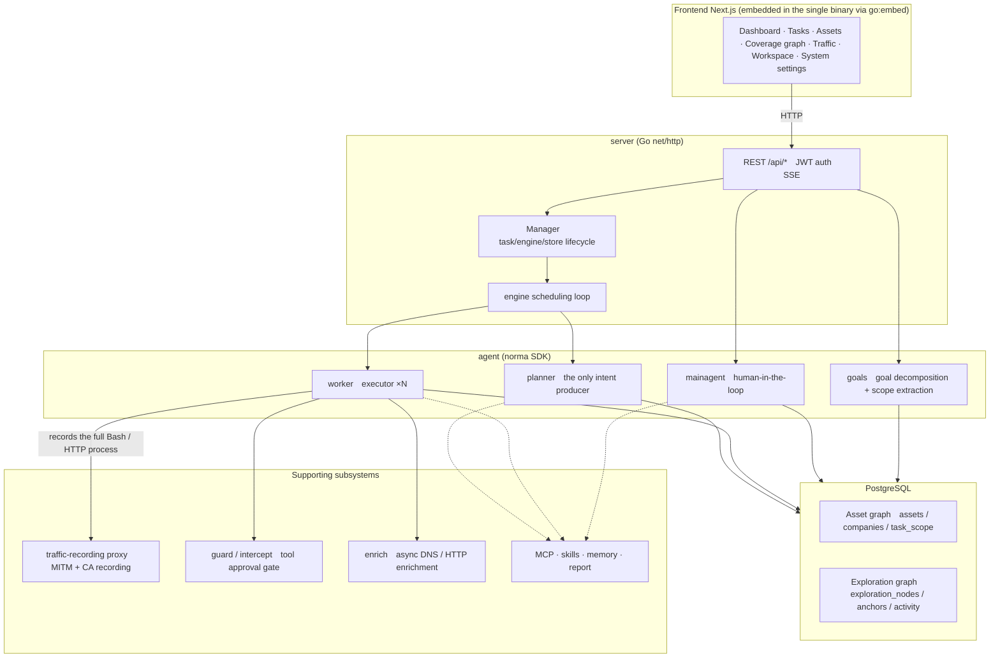
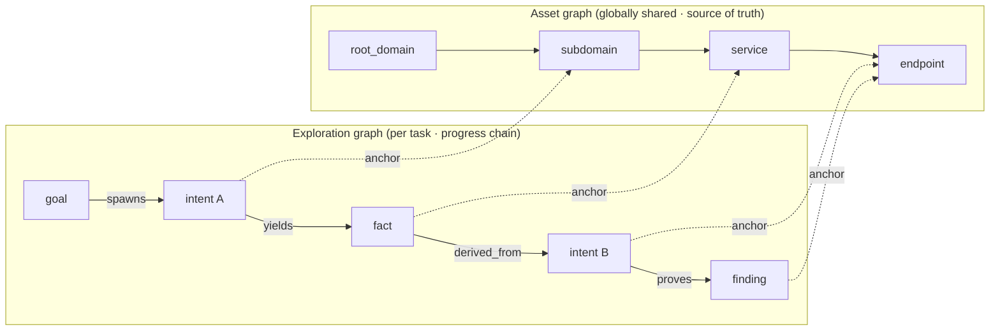
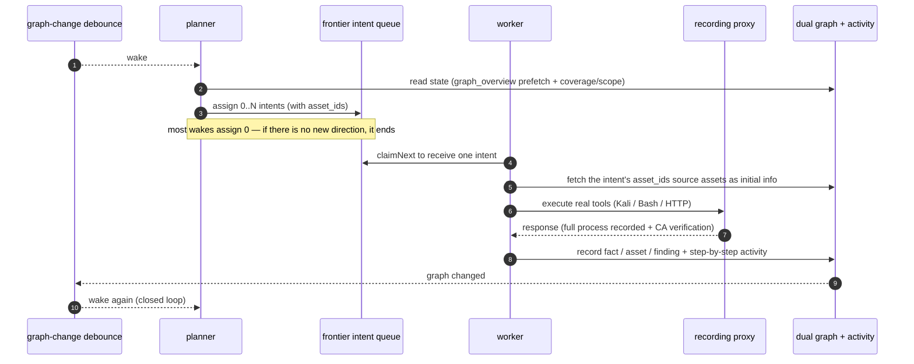
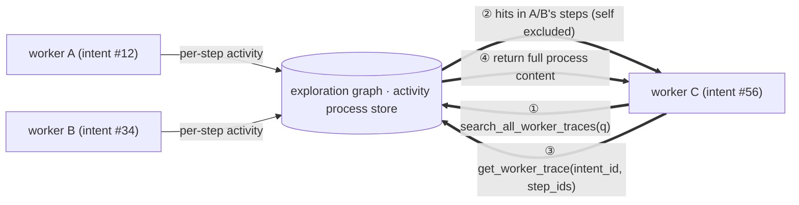
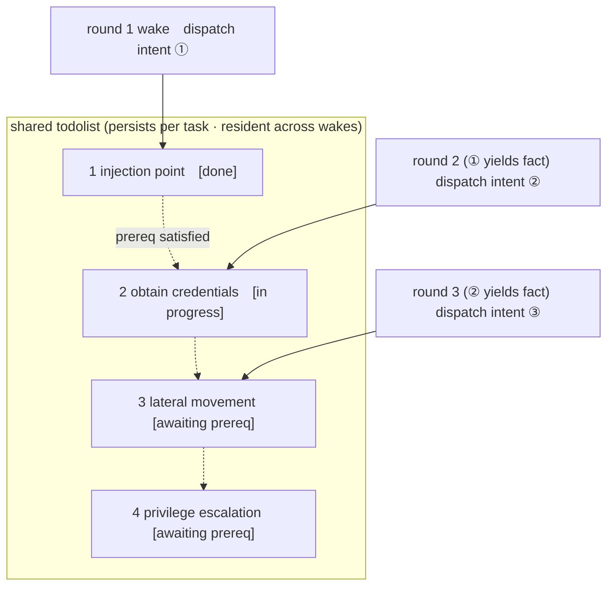

<div align="center">

# ARTEX — Global Edition

**ระบบทดสอบเจาะระบบอัตโนมัติที่ขับเคลื่อนด้วย LLM แบบหลายเอเจนต์** (แบ็กเอนด์ Go + ฟรอนต์เอนด์ Next.js)

UI และผลลัพธ์ที่สร้างขึ้นใช้ภาษาอังกฤษเป็นค่าเริ่มต้น และ**สามารถสลับเป็นภาษาเกาหลี จีน สเปน ญี่ปุ่น หรือไทยได้ใน Settings (System → Settings → Display language)** การเปลี่ยนภาษาจะเปลี่ยนภาษาของรายงาน บทสรุป และคำตอบในแชตที่เอเจนต์สร้างขึ้นด้วย

[English](README.md) · [한국어](README.ko.md) · [中文](README.zh.md) · [Español](README.es.md) · [日本語](README.ja.md) · ไทย

[](https://github.com/jiwoochris/artex-global/actions/workflows/ci.yml) [](https://github.com/jiwoochris/artex-global/actions/workflows/detections.yml) [](https://github.com/jiwoochris/artex-global/actions/workflows/web.yml) [](LICENSE)

</div>

---

> ## 🚨 คำเตือนด้านความปลอดภัยและการนำไปใช้ในทางที่ผิด — โปรดอ่านก่อน
>
> **ที่เก็บโค้ดนี้เผยแพร่ให้ใช้เฉพาะในสภาพแวดล้อมที่ได้รับอนุญาต และเพื่อสร้างขีดความสามารถด้านการป้องกันและการตรวจจับเท่านั้น**
>
> ARTEX เป็นเครื่องมือโจมตีอัตโนมัติที่ทรงพลังพอจะนำการโจมตีตั้งแต่การสำรวจ การบุกรุก ไปจนถึงการนำข้อมูลออกโดยมีมนุษย์เกี่ยวข้องน้อยมาก ความเสียหายจากการนำไปใช้ในทางที่ผิดจึงมีมากตามไปด้วย ในเดือนตุลาคม 2026 สื่อเกาหลีหลายแห่งรายงานว่าผู้สืบสวนพบสัญญาณว่า ARTEX ต้นฉบับ (upstream) ถูกใช้ในเหตุละเมิดข้อมูลส่วนบุคคลที่มุ่งเป้าไปยังสถาบันการเงินของเกาหลี การสอบสวนที่เกี่ยวข้องยังดำเนินอยู่ Global edition นี้ไม่ได้เผยแพร่เพื่อช่วยผู้โจมตี วัตถุประสงค์คือช่วยให้ฝ่ายป้องกันเข้าใจว่าการโจมตีด้วย AI อัตโนมัติเช่นนี้ทำงานอย่างไร และสร้างขีดความสามารถในการตรวจจับและสกัดกั้น
>
> - **การใช้งานโดยไม่ได้รับอนุญาตเป็นอาชญากรรมในตัวเอง** ห้ามสแกน สำรวจ หรือโจมตีช่องโหว่ระบบที่คุณไม่ได้เป็นเจ้าของ หรือที่คุณไม่มีหนังสืออนุญาตอย่างชัดแจ้ง ในสาธารณรัฐเกาหลี การบุกรุกเครือข่ายข้อมูลและการสื่อสารโดยไม่ได้รับอนุญาตเป็นการละเมิด Network Act และหากเกี่ยวข้องกับข้อมูลส่วนบุคคล Personal Information Protection Act ก็มีผลบังคับใช้ด้วย
> - **อย่าโจมตีบริการที่เปิดใช้งานจริงหรือทรัพย์สินของผู้อื่น** ให้ตรวจสอบเฉพาะในสภาพแวดล้อมสำหรับการเรียนรู้ การวิจัย และสภาพแวดล้อมที่แยกขาดในเครื่องที่คุณเป็นเจ้าของ (เป้าหมายที่จงใจให้มีช่องโหว่ เช่น OWASP Juice Shop หรือ DVWA)
> - **อ่านจากมุมมองของผู้ป้องกัน** ที่เก็บโค้ดนี้ยังรวบรวมเอกสารด้านการป้องกันและการตรวจจับ เช่น ลายเซ็นการตรวจจับและเช็กลิสต์การเสริมความแข็งแกร่ง สำหรับการโจมตีด้วย AI อัตโนมัติ → **[คู่มือการป้องกันและตรวจจับ (Defense & Detection Guide)](docs/defense-en.md)** (มีฉบับ[ภาษาเกาหลี](docs/defense-ko.md)ด้วย)
>
> หากคุณไม่เห็นด้วยกับคำเตือนนี้และกับ[ข้อจำกัดการใช้งานและข้อสงวนสิทธิ์](#ใบอนุญาตและข้อสงวนสิทธิ์)ด้านล่าง อย่าดาวน์โหลดหรือใช้ที่เก็บโค้ดนี้

---

> **ที่เก็บโค้ดนี้เป็นฉบับท้องถิ่น (localized edition) ของโปรเจกต์โอเพนซอร์สจีน [Autumn-27/ARTEX](https://github.com/Autumn-27/ARTEX) (AGPL-3.0 · ปัจจุบันเข้าถึงที่เก็บโค้ดต้นฉบับไม่ได้ ตรวจสอบเมื่อ 2026-10) ปรับให้ผู้ใช้และทีมทั่วโลกนำไปใช้ได้ทันที** เพื่อรักษาประสิทธิภาพการตัดสินใจของเอเจนต์ พรอมต์การให้เหตุผลภายในจึงคงไว้เป็นภาษาต้นฉบับ และบังคับเฉพาะผลลัพธ์ที่ผู้ใช้เห็น (ผลตรวจพบ บทสรุป รายงาน คำตอบในแชต) ให้เป็นภาษาที่เลือก (ค่าเริ่มต้นคือภาษาอังกฤษ) ดูเหตุผลได้ที่ ["เหตุใดจึงมีฉบับ Global"](#เหตุใดจึงมีฉบับ-global) ด้านล่าง

ARTEX คือระบบที่เอเจนต์ที่ขับเคลื่อนด้วย LLM หลายตัวทำการทดสอบเจาะระบบโดยอัตโนมัติ: เอเจนต์ **แตกเป้าหมายออกเป็นงานย่อยด้วยตนเอง รันเครื่องมือจริง และสะสมทรัพย์สินกับช่องโหว่ที่พบลงในกราฟ** ไปตลอดทาง ไบนารี Go ตัวเดียวฝังฟรอนต์เอนด์ Next.js มาให้ และข้อมูลทั้งหมดเก็บใน PostgreSQL

> **หมายเหตุเกี่ยวกับภาษาของฉบับนี้** ฟอร์กนี้ทำให้ผลิตภัณฑ์ใช้งานได้ใน 6 ภาษา — **อังกฤษ (ค่าเริ่มต้น), เกาหลี, จีน, สเปน, ญี่ปุ่น และไทย** — เลือกได้ใน Settings ผลลัพธ์ที่ผู้ใช้เห็นจะถูกบังคับให้เป็นภาษาที่เลือก ขณะที่พรอมต์การให้เหตุผลภายในของเอเจนต์ยังคงเป็นภาษาต้นฉบับเพื่อรักษาประสิทธิภาพที่ผ่านการทดสอบเบนช์มาร์กแล้ว ดู[การตั้งค่า](#การตั้งค่า)สำหรับวิธีที่ภาษาของผลลัพธ์ถูกบังคับด้วยคำสั่งสั้นๆ ที่ตรึงไว้ในโค้ด

---

## ⚠️ อ่านก่อน — การใช้งานที่ได้รับอนุญาตและประกาศทางกฎหมาย

ใช้ ARTEX ได้ **เฉพาะกับเป้าหมายที่คุณเป็นเจ้าของ หรือที่คุณมีหนังสืออนุญาตอย่างชัดแจ้ง** การสแกน สำรวจ หรือโจมตีช่องโหว่นอกขอบเขตที่ได้รับอนุญาตอาจผิดกฎหมายได้ด้วยตัวมันเอง

- ในสาธารณรัฐเกาหลี การบุกรุกหรือขัดขวางเครือข่ายข้อมูลและการสื่อสารของผู้อื่นโดยไม่ได้รับอนุญาตเป็นการละเมิด **Act on Promotion of Information and Communications Network Utilization and Information Protection** (정보통신망법)
- ข้อมูลส่วนบุคคลที่เก็บรวบรวมหรือถูกเปิดเผยระหว่างการทดสอบเจาะระบบอยู่ภายใต้ **Personal Information Protection Act** (개인정보보호법) ของเกาหลี แม้จะได้รับอนุญาตแล้ว ก็ควรจัดการการเข้าถึง การเก็บรักษา และการลบข้อมูลส่วนบุคคลอย่างระมัดระวัง
- ไม่ว่าคุณจะอยู่ที่ใด ให้ปฏิบัติตามกฎหมายของเขตอำนาจของคุณเองว่าด้วยความมั่นคงปลอดภัยเครือข่าย การคุ้มครองข้อมูล และอาชญากรรมคอมพิวเตอร์
- ใช้เพื่อ **การเรียนรู้ การวิจัย และการตรวจสอบในสภาพแวดล้อมที่แยกขาดในเครื่อง** ก่อนจะมุ่งเป้าไปยังระบบภายนอกที่เปิดใช้งานจริง ต้องมีหนังสืออนุญาต พร้อมขอบเขตและช่วงเวลาที่ตกลงกันไว้

เงื่อนไขใบอนุญาตฉบับเต็ม ข้อจำกัดการใช้งาน และข้อสงวนสิทธิ์อยู่ในหัวข้อ [ใบอนุญาตและข้อสงวนสิทธิ์](#ใบอนุญาตและข้อสงวนสิทธิ์) ด้านล่าง การใช้เครื่องมือนี้ถือว่าคุณยอมรับเงื่อนไขเหล่านั้น

---

## เหตุใดจึงมีฉบับ Global

ARTEX ต้นฉบับมีพรอมต์ UI และเอกสารเป็นภาษาจีนทั้งหมด ทำให้ผู้ที่อ่านภาษาจีนไม่ออกลำบากในการอ่านผลลัพธ์และแบ่งปันกับทีม ฉบับนี้มีเป้าหมายดังนี้

- **ปรับผลลัพธ์ให้เป็นภาษาท้องถิ่น** — ผลตรวจพบ สรุปข้อเท็จจริง รายงานฉบับสุดท้าย และคำตอบในแชตที่เอเจนต์นำเสนอต่อมนุษย์ ถูกบังคับให้เป็นภาษาที่เลือก (ค่าเริ่มต้นคืออังกฤษ; เลือกเกาหลี จีน สเปน ญี่ปุ่น และไทยได้) คำสั่ง เพย์โหลด โค้ด URL และล็อกดิบจำเป็นต่อการวิเคราะห์ จึงคงรูปเดิมไว้
- **รักษาประสิทธิภาพ** — พรอมต์การให้เหตุผลภายใน (เนื้อหาคำสั่งด้านพฤติกรรม) ที่ขับเคลื่อนการตัดสินใจของเอเจนต์ **ไม่ได้** ถูกแปล พฤติกรรมที่ผ่านเบนช์มาร์กในภาษาต้นฉบับยังคงเดิม เปลี่ยนเฉพาะภาษาของผลลัพธ์ จึงหลีกเลี่ยงคุณภาพที่เพี้ยนไปจากการแปล
- **ระบุขอบเขตทางกฎหมายให้ชัด** — คำเตือน "เฉพาะขอบเขตที่ได้รับอนุญาต" ระบุไว้อย่างชัดเจน พร้อมประกาศเฉพาะของเกาหลีว่าด้วยกฎหมายเครือข่ายและความเป็นส่วนตัว (ผู้ดูแลอยู่ในเกาหลี) และกฎหมายของพื้นที่ที่คุณปฏิบัติงานก็มีผลด้วยเช่นกัน
- **รองรับสแต็ก LLM หลากหลาย** — ผู้ให้บริการ LLM เปลี่ยนจากโมเดลระดับแนวหน้าไปเป็นเอนด์พอยต์ที่เข้ากันได้กับ OpenAI ใดๆ ได้ (โมเดลในประเทศหรือโมเดลเปิด) ดู[การตั้งค่า](#การตั้งค่า)

> ขอบเขตและนโยบายการออกแบบของฉบับหลายภาษานี้มีบันทึกรายละเอียดเพิ่มเติมในบันทึกการทำงานของที่เก็บโค้ด เพื่อให้เทียบกับที่เก็บโค้ดต้นฉบับได้ง่าย เอกสารภาษาจีนต้นฉบับจึงเก็บรักษาไว้เป็น [`README.zh.md`](README.zh.md)

---

## ภาพหน้าจอ

สามหน้าจอด้านล่างแสดง UI ภาษาอังกฤษซึ่งเป็นค่าเริ่มต้น (สลับเป็นเกาหลี จีน สเปน ญี่ปุ่น และไทยได้ใน Settings) ข้อมูลมาจากแซนด์บ็อกซ์ที่แยกขาดในเครื่อง: เป้าหมายทั้งหมดคือ `acme.com` ที่สมมติขึ้น และช่วงที่อยู่ส่วนตัว

<p align="center">
  <br>
  <sub><b>Dashboard</b> — งานที่กำลังทำงาน ผลตรวจพบที่ยืนยันแล้ว โหนดทรัพย์สิน ค่าโทเค็น LLM ที่ใช้ไป และฟีดกิจกรรม ในหน้าจอเดียว</sub>
</p>

<p align="center">
  <br>
  <sub><b>Findings</b> — ผลลัพธ์ที่รวมตามความรุนแรง สถานะ ทรัพย์สิน และงานที่เป็นเจ้าของ ส่งออกเป็น CSV ได้</sub><br>
  <sub><b>ชื่อ</b>ของผลตรวจพบสร้างโดยโมเดล จึงอาจมีศัพท์เทคนิคภาษาอังกฤษปรากฏ ซึ่งสะท้อนแอปเป้าหมาย ([การเลือกโมเดลและภาษาของผลลัพธ์](#การเลือกโมเดลและภาษาของผลลัพธ์)) คำอธิบายใต้แต่ละชื่อและ UI ส่วนที่เหลือเป็นภาษาอังกฤษ (ค่าเริ่มต้น; สลับได้ใน Settings)</sub>
</p>

<p align="center">
  <br>
  <sub><b>Chat</b> — มนุษย์เข้ามาแทรกคำใบ้ในการทำงานอัตโนมัติ ขณะที่เอเจนต์สรุปห่วงโซ่การโจมตีเป็นภาษาอังกฤษ</sub>
</p>

หน้าจอต้นฉบับ (UI ภาษาจีน) ดูได้ใน [`README.zh.md`](README.zh.md#截图预览) (UI ภาษาจีน)

---

## เริ่มต้นอย่างรวดเร็ว (Docker Compose)

> **ข้อกำหนดเบื้องต้น:** Docker และ Docker Compose ฐานข้อมูลคือ **PostgreSQL** ซึ่ง compose จะยกขึ้นให้ การสำรวจต้องใช้ **LLM** (`ANTHROPIC_API_KEY` หรือ `OPENAI_API_KEY`; ตั้งค่าใน UI ได้เช่นกัน)

> **อิมเมจ:** เซอร์วิส `artex` ใน `docker-compose.yml` ดึง `ghcr.io/jiwoochris/artex-global` ซึ่งเป็นอิมเมจ global edition ที่ที่เก็บโค้ดนี้เผยแพร่ไปยัง GitHub Container Registry ทุกครั้งที่ติดแท็กรีลีส (`v*`) แท็กเริ่มต้นคือ `latest` (รีลีสล่าสุด); ตั้งค่า `ARTEX_TAG` ใน `.env` เพื่อตรึงรีลีสที่ต้องการ อิมเมจต้นฉบับ `autumn27/artex` ถูกถอดออกจาก Docker Hub แล้วและไม่ได้ใช้อีก

```bash
git clone https://github.com/jiwoochris/artex-global.git
cd artex-global
cp .env.example .env          # set POSTGRES_PASSWORD; ANTHROPIC_API_KEY is optional
docker compose up -d          # brings up the artex image + postgres together
# → open http://localhost:8787 (on first visit, set the admin password at /setup)
#   /setup asks for the setup token printed in the startup log: docker compose logs artex | grep -F '[auth]'
```

อิมเมจรวมเครื่องมือทั่วไปไว้ให้ (ripgrep, curl, vim, npm, nmap และอื่นๆ) และเมื่อยกด้วย compose ไดเรกทอรี `./skills` และ `./data` จะถูก bind-mount ไปยังโฮสต์และอยู่รอดแม้สร้างคอนเทนเนอร์ใหม่

### วิธีติดตั้งแบบอื่น

ต้นฉบับมีหลายวิธี: สคริปต์ติดตั้ง (`./install.sh`) ไบนารีที่คอมไพล์แล้ว (Releases) และการบิลด์ไบนารีเดียวจากซอร์ส คำสั่งและขั้นตอนทั้งหมดรวบรวมไว้ในหัวข้อ "安装" (การติดตั้ง) ของ [`README.zh.md`](README.zh.md#安装) (เป็นภาษาจีน) ส่วนสาระสำคัญสรุปไว้ด้านล่าง

- **สคริปต์ติดตั้ง:** เมื่อรัน `./install.sh` สคริปต์จะตรวจพบ/ติดตั้ง Docker แล้วให้คุณเลือก "① all-in-Docker" หรือ "② คอมไพล์และรันในเครื่อง" โดย "① all-in-Docker" จะดึงและเริ่มอิมเมจเดียวกับการเริ่มต้นอย่างรวดเร็วด้านบน (`ghcr.io/jiwoochris/artex-global`) ส่วน "② คอมไพล์และรันในเครื่อง" คือบิลด์เองด้วยวิธีเดียวกับ**การบิลด์ไบนารีเดียวจากซอร์ส**ด้านล่าง
- **การบิลด์ไบนารีเดียวจากซอร์ส:**

  ```bash
  cd web && npm ci && npm run build:static && cd ..   # 1) static frontend build
  rm -rf server/webui/dist && mkdir -p server/webui/dist && cp -a web/out/. server/webui/dist/   # 2) sync into the embed directory (avoids nesting on rebuild)
  CGO_ENABLED=0 go build -tags embedui -o artex ./cmd/artex   # 3) compile with the frontend embedded
  ./start.sh                                          # → http://localhost:8787
  ```

> `npm ci` ในขั้นตอนที่ 1) ติดตั้ง devDependencies ที่การบิลด์ต้องใช้ (เช่น `@tailwindcss/postcss`) หากเชลล์ของคุณตั้ง `NODE_ENV=production` ไว้ `npm ci` จะข้าม devDependencies และการบิลด์จะล้มเหลวพร้อม `Error: Cannot find module '@tailwindcss/postcss'`; ในกรณีนั้นให้ติดตั้งด้วย `npm ci --include=dev`

> ให้เริ่มด้วย `start.sh` (`start.bat` บน Windows) แทนการรัน `./artex` โดยตรง สคริปต์นั้นเป็นซูเปอร์ไวเซอร์ที่รีสตาร์ตโปรแกรมตามรหัสออก และยังจัดการ "อัปเดตคลิกเดียว" ของ UI ด้วย

---

## การตั้งค่า

**ฐานข้อมูล** (`config.json` หรือแทนที่ด้วยตัวแปรสภาพแวดล้อม `ARTEX_PG_DSN`):

```json
{
  "database": {
    "host": "127.0.0.1", "port": 5432,
    "user": "artex", "password": "yourpass",
    "dbname": "artex", "sslmode": "disable"
  }
}
```

**LLM:** `export ANTHROPIC_API_KEY=sk-...` (หรือ `OPENAI_API_KEY`) หรือกรอกในหน้า "LLM settings" ของ UI ตัวแปรสภาพแวดล้อมเสริม: `ARTEX_LLM_PROVIDER` / `ARTEX_LLM_MODEL` / `ARTEX_LLM_BASE_URL` / `ARTEX_LLM_PROXY` หากต้องการใช้โมเดลในประเทศหรือโมเดลเปิด ให้ชี้ `ARTEX_LLM_BASE_URL` ไปยังเอนด์พอยต์ที่เข้ากันได้กับ OpenAI

**ภาษาของผลลัพธ์:** ฉบับนี้บังคับผลลัพธ์ที่ผู้ใช้เห็นให้เป็นภาษาที่เลือก (ค่าเริ่มต้นคืออังกฤษ) ผ่านคำสั่งสั้นๆ ที่ตรึงไว้ในโค้ดและต่อท้ายซิสเต็มพรอมต์ของแต่ละบทบาท (ไม่ได้แปลเนื้อหาการให้เหตุผล) สลับภาษาได้ใน Settings หรือปรับคำสั่งนั้นใน `agent/prompt.go` (`langDirective`)

**การทำงานพร้อมกัน:** จำนวนเวิร์กเกอร์เอเจนต์ที่สร้างต่อหนึ่งงานปรับได้ใน "System settings" (ค่าเริ่มต้น 3)

**แฟลกที่ใช้บ่อย:** `./start.sh -addr :8787 -proxy :8788` — `-addr` คือฟรอนต์เอนด์และ API, `-proxy` คือพอร์ตพร็อกซีบันทึกทราฟฟิก ค่าเริ่มต้นของ `-addr` คือ `127.0.0.1:8787` (รับเฉพาะการเชื่อมต่อในเครื่อง); ระบุที่อยู่ bind อย่างชัดเจน เช่น `:8787` เพื่อให้บริการเครื่องอื่น (ดู "การป้องกันเมื่อรันครั้งแรก" ด้านล่าง)

### การเลือกโมเดลและภาษาของผลลัพธ์

การบังคับภาษาของผลลัพธ์ **ขับเคลื่อนด้วยคำสั่งในพรอมต์ (`langDirective()` ใน `agent/prompt.go`) ไม่ใช่เพดานที่ฮาร์ดโค้ด** ดังนั้นผลลัพธ์จะคงอยู่ในภาษาที่เลือกได้สม่ำเสมอเพียงใดขึ้นอยู่กับความสามารถของโมเดล บทบาท และบริบท ตัวเลขการตรวจสอบด้านล่างวัดด้วยผลลัพธ์ภาษาเกาหลีในช่วงที่เกาหลีเป็นค่าเริ่มต้น แนวโน้มเดียวกันใช้ได้กับภาษาอื่น

- **ใช้โมเดลระดับแนวหน้าที่มีความสามารถ** ในการรันตรวจสอบสั้นๆ ที่ใช้เฉพาะคำสั่งระดับโปรดักชันกับแซนด์บ็อกซ์แยกขาดในเครื่อง โมเดลเริ่มต้น `claude-opus-4-8` คงผลลัพธ์ที่ผู้ใช้เห็นเป็นภาษาเกาหลีได้ทั้งสี่บทบาท — planner, worker, reporter และคำขอวางแผนในแซนด์บ็อกซ์ที่ได้รับอนุญาต — โดยไม่มีการปฏิเสธ `gpt-4o` ก็คงภาษาเกาหลีได้ในสถานการณ์เดียวกัน ในทางกลับกัน โมเดลที่ถูกกว่าและเล็กกว่า (เช่น `gpt-4o-mini`) ปล่อยให้รายงานย้อนกลับไปเป็นภาษาต้นฉบับ คุณภาพภาษาของผลลัพธ์แปรผันตรงกับความสามารถของโมเดล จึงควรใช้โมเดลที่มีความสามารถในทุกที่ที่มนุษย์อ่านรายงาน
- **ยังมีการเบี่ยงเบนตามบทบาทและบริบทอยู่บ้าง** ความแตกต่างปรากฏที่บทบาทและรูปแบบผลลัพธ์มากกว่าตัวภาษาเอง โดยเฉพาะผลลัพธ์สั้นๆ เช่น สรุปประโยคเดียวสุดท้ายของ worker ที่อาจเปิดเผย chain-of-thought ภาษาอังกฤษของโมเดลตามตัวอักษร และฟิลด์โครงสร้างของ `report_finding` ที่อาจเอนไปทางภาษาอังกฤษ สะท้อนแอปเป้าหมายและศัพท์เทคนิคของมัน ในการรันก่อนหน้านี้ สรุปสถานการณ์ของ planner จาก `gpt-4o` ก็ย้อนกลับไปเป็นภาษาต้นฉบับในบางรอบ การระบุ "write in the selected language" อย่างชัดเจนในคำสั่งงานช่วยเพิ่มความแม่นยำ
- **ให้ `max_tokens` ที่เผื่อไว้มากแก่โมเดลที่ใช้การให้เหตุผล** โมเดลที่ให้เหตุผลซึ่งใช้ช่องทางคิดแยกต่างหากอาจใช้งบโทเค็นของคำตอบเล็กๆ หมดไปกับการให้เหตุผลภายใน แล้วปล่อยคำตอบสุดท้ายที่ผู้ใช้เห็นให้ว่าง กรณีนี้ตัวคำตอบหายไปแทนที่จะเป็นภาษา จึงควรตั้ง `max_tokens` ของโปรไฟล์ LLM นั้นให้สูงพอ

> **กับดักเพดานโทเค็นบนเส้นทางที่เข้ากันได้กับ OpenAI** โมเดลตระกูล OpenAI เช่น `gpt-4o` จำกัดโทเค็นคำตอบที่ 16,384 แต่คำขอที่เข้ากันได้กับ OpenAI มีเพดานผลลัพธ์เริ่มต้นที่ใหญ่กว่า (32,768) หากไม่เปลี่ยน ทุกการเรียกจะล้มเหลวด้วย `400 (max_tokens is too large)` ในกรณีนั้น **ให้ตั้ง `max_tokens` ของโปรไฟล์นั้นเป็น 16,384 หรือต่ำกว่าในหน้า LLM settings** โมเดลตระกูล Anthropic (รวมถึง `claude-opus-4-8` ซึ่งเป็นค่าเริ่มต้น) รองรับ 32,768 และไม่เจอกับดักนี้

### การป้องกันเมื่อรันครั้งแรก (setup token และที่อยู่ bind)

มีบัญชีผู้ดูแลระบบเพียงบัญชีเดียว (`ARTEX`) ซึ่งรหัสผ่านสร้างขึ้นเมื่อเข้าชมครั้งแรกที่ `/setup` เพื่อไม่ให้ผู้ที่เข้าถึงอินสแตนซ์ที่ยังไม่ได้เริ่มต้นเป็นคนแรกยึดครองได้ จึงมีการป้องกันดังต่อไปนี้

- **Setup token** เมื่อเซิร์ฟเวอร์เริ่มโดยยังไม่มีรหัสผ่าน จะพิมพ์หนึ่งบรรทัด `[auth] … Setup token: …` ไปยังคอนโซล (`docker compose logs artex` เมื่อใช้ Docker) `/setup` และ `POST /api/auth/init` (ฟิลด์ `setup_token`) จะสร้างรหัสผ่านก็ต่อเมื่อค่านั้นตรงกัน และความพยายามที่ผิดจะถูกจำกัดอัตรา สำหรับการติดตั้งแบบไม่มีผู้ดูแล ให้ตรึงด้วย `ARTEX_SETUP_TOKEN` หรือตั้งรหัสผ่านโดยตรงด้วย `ARTEX_ADMIN_PASSWORD` (8 ตัวอักษรขึ้นไป)
- **Bind ที่ 127.0.0.1 เป็นค่าเริ่มต้น** ทั้งค่าเริ่มต้นของ `-addr` ใน `artex` และการเผยแพร่พอร์ตใน `docker-compose.yml` เปิดเฉพาะอินเทอร์เฟซ loopback หากต้องการเข้าถึงจากเครื่องอื่นให้ใช้ `-addr :8787` หรือ `ARTEX_BIND=0.0.0.0` ใน `.env` แต่ให้ตั้งค่าเริ่มต้นให้เสร็จก่อน และควรใช้รูปแบบ reverse-proxy ด้านล่าง การเริ่มโดยไม่มีรหัสผ่านบนที่อยู่ที่ไม่ใช่ loopback จะบันทึกคำเตือน
- **การเปลี่ยนรหัสผ่านจะสิ้นสุดทุกเซสชัน** คีย์ลงนามโทเค็นผูกกับแฮชของรหัสผ่าน ดังนั้นโทเค็นที่ออกก่อนการเปลี่ยน (จาก UI, `reset-password.sh` หรือแก้ DB โดยตรง) จะใช้ไม่ได้ภายในไม่กี่วินาที เมื่อกู้คืนจากบัญชีที่ถูกบุกรุก ให้ตรวจสอบเครื่องมือกำหนดเอง, MCP, LLM และการตั้งค่าการแจ้งเตือนหลังเปลี่ยนรหัสผ่านด้วย
- **CORS** `/api` ตอบเฉพาะการเรียกข้ามต้นทางจากเบราว์เซอร์ที่มาจากต้นทางที่ระบุใน `ARTEX_CORS_ORIGINS` (คั่นด้วยจุลภาค) UI ที่ฝังมาเป็นต้นทางเดียวกัน จึงมักเว้นว่างไว้; ค่าเริ่มต้นอนุญาตเฉพาะ `next dev` จาก `dev.sh` (`http://localhost:5173`)

### การติดตั้งหลัง reverse proxy (HTTPS / เปิดเฉพาะ 443)

ฟรอนต์เอนด์และ API/SSE ให้บริการจากพอร์ตแบ็กเอนด์เดียวกัน (ค่าเริ่มต้น `:8787`) และสตรีมกิจกรรมสดเชื่อมต่อแบบ **same-origin** เป็นค่าเริ่มต้น จึงไม่ต้องตั้ง `NEXT_PUBLIC_SSE_BASE` แยกต่างหาก: เปิดเฉพาะ 443 สู่เครือข่ายสาธารณะ และเก็บ 8787 ไว้ภายใน

SSE คงการเชื่อมต่อยาวและส่งอีเวนต์ต่อเนื่อง ดังนั้นคุณ **ต้องปิดการบัฟเฟอร์** ใน reverse proxy หากไม่ปิด เบราว์เซอร์จะเชื่อมต่อได้แต่ไม่ได้รับอีเวนต์ (สตรีมกิจกรรมดูเหมือนโหลดค้าง) ตัวอย่างการตั้งค่า Nginx อยู่ใน [`README.zh.md`](README.zh.md#反向代理部署https--只开放-443)

---

## สถาปัตยกรรมระบบ

ARTEX คือ **ระบบเจาะระบบอัตโนมัติที่ขับเคลื่อนด้วย LLM แบบหลายเอเจนต์** ใช้แบ็กเอนด์ Go ตัวเดียว (ฝังฟรอนต์เอนด์ Next.js) บน PostgreSQL และขีดความสามารถของเอเจนต์มาจาก SDK [`norma`](https://github.com/Autumn-27/norma) (ปัจจุบันเข้าถึงไม่ได้ ตรวจสอบเมื่อ 2026-10) แกนกลางคือ **โครงสร้างกราฟคู่** และกลไกอัตโนมัติสองอย่างรอบๆ มัน: การแลกเปลี่ยนข้อมูลระดับกระบวนการระหว่างเวิร์กเกอร์ และ todolist ร่วมหลายรอบของ planner

### เลเยอร์โดยรวม



- **Frontend** — บิลด์สแตติกของ Next.js ถูกฝังในไบนารีเดียวด้วย `go:embed` แสดงภาพงาน ทรัพย์สิน ห่วงโซ่การสำรวจ และกราฟความครอบคลุม พร้อมแชต human-in-the-loop
- **server** — จัดการเส้นทาง `net/http` การยืนยันตัวตน JWT และ SSE; `Manager` เป็นเจ้าของวงจรชีวิตของงาน engine และ DB store
- **engine** — ต่อหนึ่งงาน รัน `plannerLoop` หนึ่งตัวและ worker goroutine จำนวน N ตัว จัดการการมอบหมาย intent การหมดเวลา การหยุดชั่วคราว และ drain
- **agent** — แบ่งเป็น goals / planner / worker / mainagent; `ToolSet` เปิดเผยกราฟคู่เป็นเครื่องมือของ LLM
- **db** — เก็บกราฟคู่ใน PostgreSQL (pgx); สคีมาที่ฝังด้วย `go:embed` สร้างตารางแบบ idempotent ทุกครั้งที่เริ่มต้น
- **support** — พร็อกซี MITM ที่บันทึก, approval gate, การเสริมข้อมูลแบบอะซิงก์ และ MCP / skills / memory / report

### กราฟคู่: กราฟการสำรวจ + กราฟทรัพย์สิน

ระบบแยก "เป้าหมายคืออะไร" ออกจาก "ทดสอบไปไกลแค่ไหน" เป็นสองกราฟที่เป็นอิสระต่อกันแต่เชื่อมโยงด้วย anchor

- **กราฟทรัพย์สิน (ใช้ร่วมทั่วระบบ)** — คลังทรัพย์สินที่เป็นแหล่งความจริงซึ่งใช้ร่วมกันข้ามงาน โหนดคือ `root_domain / subdomain / ip / service / app / endpoint` และสังกัดบริษัท ความสัมพันธ์พ่อ-ลูก (domain → subdomain → service → endpoint) และคีย์การขจัดข้อมูลซ้ำล้วนคำนวณโดยโปรแกรม เอเจนต์ส่งเพียงข้อมูลดิบ
- **กราฟการสำรวจ (แยกอิสระต่องาน)** — "ความคิดและความคืบหน้า" ของงานหนึ่งๆ โหนดคือ `goal / intent / fact / finding / hint` เชื่อมด้วยขอบ เช่น `spawns / derived_from / yields / proves` เพื่อสร้างสายสืบทอด
- **สองกราฟเชื่อมกันด้วย anchor** — `exploration_anchors(node_id, asset_id)` ตรึง intent, fact และ finding เข้ากับทรัพย์สินที่เป็นรูปธรรม ทำให้คุณสืบค้นได้สองทิศทาง: จากฝั่งการสำรวจว่าทิศทางหนึ่งโจมตีทรัพย์สินใดอยู่ และกลับกัน ว่า intent ใดทดสอบทรัพย์สินหนึ่งๆ ในงานนี้และให้ fact อะไรบ้าง



> การแบ่งบทบาท: **planner** อ่านสถานะของกราฟการสำรวจและตัดสินเป้าหมาย โดยส่ง **intent** ไปยัง frontier เฉพาะเมื่อมีทิศทางใหม่ที่ยังไม่ครอบคลุม **worker** รับ **intent เดียว** รันด้วยเครื่องมือจริง เขียนทรัพย์สิน/fact/finding ใหม่ลงทั้งสองกราฟ แล้วหยุด กราฟทรัพย์สินคือความจริงร่วม; กราฟการสำรวจคือห่วงโซ่ความคืบหน้าต่องาน

### Engine และวงจรชีวิตของ intent (วงวนการสำรวจแบบปิดหนึ่งรอบ)

Engine เป็นวงวนปิดแบบ **ขับเคลื่อนด้วยอีเวนต์** เมื่อกราฟเปลี่ยน มันปลุก planner; เมื่อ planner ส่ง intent ออกมา worker จะรับไปรันและเขียนผลลัพธ์; การเขียนนั้นก็กระตุ้นรอบถัดไป วงจรนี้ดำเนินต่อไปจนเป้าหมายได้รับการพิสูจน์ (`prove_goal`)



### การแลกเปลี่ยนข้อมูลระดับกระบวนการระหว่างเวิร์กเกอร์

ในการสำรวจเชิงลึก ข้อสังเกตที่มีค่า (ข้อผิดพลาดบางอย่าง ส่วนของการตอบกลับ พารามิเตอร์ที่ซ่อนอยู่) มักเกิดขึ้นระหว่าง **กระบวนการรัน** ของ worker ตัวหนึ่งโดยไม่ได้บันทึกเป็น fact อย่างเป็นทางการ เพื่อหลีกเลี่ยงการทำงานซ้ำซ้อนและให้ worker รุ่นหลังต่อยอดจากข้อสังเกตก่อนหน้าได้ worker สามารถ **ค้นหากระบวนการของ worker ตัวอื่น**

- `search_all_worker_traces(q)` — ค้นหากระบวนการรันของ worker ตัวอื่นในงานเดียวกันด้วยคีย์เวิร์ด (ขั้นตอน intent ของ worker เองจะถูกตัดออกอัตโนมัติ) ผลที่พบมี `intent_id`
- `list_worker_traces` / `get_worker_trace(intent_id, step_ids=[…])` — ดูก่อนว่า worker ตัวใดรันอะไรบ้าง แล้วดึงเนื้อหาเต็มของขั้นตอนเฉพาะของ worker ที่กำหนดเพื่อแลกเปลี่ยนรายละเอียด

ด้วยวิธีนี้ แม้ในกราฟการสำรวจจะยังไม่มี fact ที่ตรงกัน worker รุ่นหลังก็นำข้อสังเกตจากกระบวนการของตัวอื่นมาใช้ซ้ำได้ ข้อมูลไหลระหว่าง worker ในระดับ "กระบวนการรัน" ขณะที่ขอบเขตยังคงอยู่ครบ (worker แต่ละตัวยังทำเฉพาะ intent เดียวที่ได้รับมอบหมาย)



### todolist ร่วมหลายรอบของ planner → ห่วงโซ่การโจมตีที่เสถียร

ห่วงโซ่การโจมตีจริงมักเป็นลำดับขั้นที่พึ่งพากัน (เช่น หาจุดฉีดคำสั่ง → ได้ข้อมูลประจำตัว → เคลื่อนที่ในแนวข้าง → ยกระดับสิทธิ์) และการส่งทั้งหมดแบบขนานพร้อมกันจะพันกันยุ่งเหยิง planner จึงถือ **todolist การวางแผนที่คงอยู่ต่องานและใช้ร่วมกันข้ามการปลุก**

- Planner ขับเคลื่อนด้วยอีเวนต์ จึงตื่นทุกครั้งที่กราฟเปลี่ยน แต่ **การตื่นแต่ละครั้งคือเซสชันใหม่** todolist ร่วมบันทึกห่วงโซ่การโจมตีแบบอนุกรม **ครั้งเดียว** แล้วในรอบถัดๆ ไปจึงมอบหมาย intent **ทีละขั้นตามลำดับการพึ่งพา** (ไม่คลี่ห่วงโซ่ทั้งหมดล่วงหน้าในรอบเดียว)
- ในแต่ละรอบ มันมอบหมาย intent ให้เฉพาะขั้นถัดไปที่ขั้นก่อนหน้าเสร็จแล้วและ fact ที่พึ่งพามีอยู่แล้ว พร้อมปรับปรุงรายการไปด้วย (ทำเครื่องหมายขั้นที่ fact ตอบสนองแล้วว่าเสร็จ)



ด้วยวิธีนี้ ห่วงโซ่การโจมตีจึงก้าวหน้าได้อย่างเชื่อถือได้แม้ในสภาพแวดล้อม "ขับเคลื่อนด้วยอีเวนต์ + เซสชันไร้สถานะ" — ไม่ซ้ำซ้อนและไม่ผิดลำดับ นี่คือหัวใจของวิธีที่ ARTEX ทำห่วงโซ่การโจมตีหลายขั้นให้เสร็จโดยอัตโนมัติ

---

## เอกสารด้านการป้องกันและการตรวจจับ

ที่เก็บโค้ดนี้มีเป้าหมายช่วย **ฝ่ายป้องกัน** ให้เข้าใจว่าการโจมตีด้วย AI อัตโนมัติทำงานอย่างไร และสร้างขีดความสามารถในการตรวจจับและสกัดกั้น โดยนำพฤติกรรมของ ARTEX ที่เห็นในสถาปัตยกรรมข้างต้นมากลับด้านเป็น **มุมมองของผู้ป้องกัน** ระบุว่าควรสังเกตอะไรและควรเสริมความแข็งแกร่งตรงไหน

- **[คู่มือการป้องกันและตรวจจับ (docs/defense-en.md)](docs/defense-en.md)** (มีฉบับ[ภาษาเกาหลี](docs/defense-ko.md)ด้วย)
  - การโจมตีด้วย AI อัตโนมัติต่างจากสแกนเนอร์แบบดั้งเดิมอย่างไร เหตุใดจึงตรวจจับยาก และจะตรวจจับได้อย่างไรอยู่ดี
  - ลายนิ้วมือที่ผู้ป้องกันสังเกตได้ (IoC และลายเซ็นเชิงพฤติกรรม) — แยกเป็นมุมมองฝั่งเป้าหมายและมุมมองด้านนิติวิทยาศาสตร์
  - จุดเข้าที่ผู้โจมตีมุ่งเป้าและการเสริมความแข็งแกร่งที่สอดคล้องกัน (การยืนยันตัวตนเสริม, IDOR, credential stuffing, เซสชันและความลับ)
  - กฎการตรวจจับจากล็อก WAF/SIEM/การยืนยันตัวตน (pseudo-rule), เช็กลิสต์การเสริมความแข็งแกร่ง และสรุปการตอบสนองต่อเหตุการณ์
  - ช่องทางทางการของเกาหลีสำหรับตัวบ่งชี้การถูกบุกรุกและประกาศเตือน (KISA, FSI, PIPC) และหน้าที่ในการรายงานตามกฎหมายเกาหลี
- **[กฎการตรวจจับที่นำไปใช้ได้ (detections/)](detections/)** — การตรวจจับลายนิ้วมือของคู่มือที่จัดส่งเป็นกฎพร้อมใช้: เลเยอร์โฮสต์/ล็อก/SIEM เป็นกฎ [Sigma](https://sigmahq.io) (atomic + correlation; ใช้ `sigma convert` สำหรับ Splunk, Elasticsearch และอื่นๆ) และเลเยอร์เครือข่ายเป็นกฎ [Suricata](https://suricata.io) ที่มุ่งเป้า User-Agent ของ enrich prober และ WebFetch ของ norma SDK
  - **[เลเยอร์ครอบคลุม ATT&CK (detections/attack/)](detections/attack/)**: เลเยอร์ [MITRE ATT&CK Navigator](https://mitre-attack.github.io/attack-navigator/) (JSON) ที่แมปกฎข้างต้นเข้ากับเทคนิคที่กฎติดแท็ก เพื่อให้เห็นได้ทันทีว่ากฎแต่ละข้อจับพฤติกรรมการโจมตีใด ทุกเทคนิคมาจากแท็ก `attack.*` ของกฎเท่านั้น ไม่มีสิ่งใดเพิ่มจากการเดา
  - **[รายการตัวบ่งชี้ที่เครื่องอ่านได้ (detections/indicators/)](detections/indicators/)**: ลายนิ้วมือเฉพาะที่ ARTEX เองปล่อยออกมา รวบรวมไว้ใน CSV ไฟล์เดียว (`artex_indicators.csv`) และจัดส่งเป็นอีเวนต์ MISP พร้อมนำเข้า (`artex_indicators.misp.json`) ด้วย เพื่อให้นำไปใส่ในตาราง lookup ของ SIEM หรือแพลตฟอร์มข่าวกรองภัยคุกคาม (MISP หรืออะไรก็ตามที่รับรูปแบบ MISP) เป็นตัวบ่งชี้การถูกบุกรุก (IoC) ได้ทันที ทุกค่าเป็นสตริงที่ตรวจสอบแล้วในซอร์สของที่เก็บโค้ด และแต่ละแถวระบุไฟล์ต้นทางและกฎการตรวจจับ
  - **[สคริปต์ triage โฮสต์ (detections/triage/)](detections/triage/)**: สคริปต์แบบอ่านอย่างเดียว [`artex_host_triage.py`](detections/triage/artex_host_triage.py) สำหรับผู้ตอบสนองเหตุที่ยืนอยู่หน้าเชลล์ของโฮสต์ที่สงสัยเพียงเครื่องเดียวโดยไม่มี SIEM หรือเซนเซอร์เครือข่าย มันตรวจลายนิ้วมือเดียวกับที่กฎข้างต้นตรวจ และเพิ่มบนเครื่องเองอีกสามตัวบ่งชี้ของโฮสต์/DB ที่ CSV ตัวบ่งชี้จงใจใส่ไว้โดยไม่มีกฎ Sigma เพราะสังเกตจากล็อกหรือเครือข่ายไม่ได้ (พอร์ตที่เซิร์ฟเวอร์รับฟัง, เอนด์พอยต์ของพร็อกซีบันทึก, สคีมาการสำรวจใน PostgreSQL) มันทำงานด้วยไลบรารีมาตรฐานล้วนๆ ไม่ต้องติดตั้งอะไร และทุกสิ่งที่พบเป็นเบาะแสสำหรับ triage ที่มีข้อควรระวังเดียวกับแถวตัวบ่งชี้ของมัน ไม่เคยเป็นการระบุตัวผู้กระทำด้วยตัวเอง
  - กฎ เลเยอร์ ตัวบ่งชี้ข้างต้น และการทดสอบตัวเองของสคริปต์ triage โฮสต์ ถูกรันซ้ำและตรวจสอบโดยการทดสอบของที่เก็บโค้ด ([detections/tests/](detections/tests/)): กฎการตรวจจับที่รันไม่ได้เป็นเพียงข้ออ้าง

> เอกสารนี้ขยายต่อเนื่อง เสนอกฎการตรวจจับหรือรายการเสริมความแข็งแกร่งเพิ่มเติมเป็น issue และเมื่อส่งกฎโดยตรง โปรดทำตามข้อกำหนดใน[หัวข้อ "การมีส่วนร่วมด้วยกฎการตรวจจับและการทดสอบการตรวจจับ" ของคู่มือการมีส่วนร่วม](CONTRIBUTING.md#contributing-detection-rules-and-detection-tests) (อ้างอิงทุกตัวบ่งชี้กับข้อเท็จจริงที่สังเกตได้, ระบุข้อจำกัด, ผ่านการตรวจสอบแบบสถิต และแนบการทดสอบที่ทำซ้ำได้)

---

## การพัฒนา

การพัฒนาและทดสอบในเครื่อง:

```bash
./dev.sh    # backend (:8787) + traffic proxy (:8788) + frontend next dev (:5173) → http://localhost:5173
```

- แบ็กเอนด์: `go run ./cmd/artex` (ถ้าไม่มี `-tags embedui` ฟรอนต์เอนด์จะไม่ถูกฝัง)
- ฟรอนต์เอนด์: `cd web && npm run dev` (พร็อกซี `/api` ไปยังแบ็กเอนด์ พร้อม hot reload)
- การทดสอบ: `go test ./...`
- พรีวิว mock (ไม่มีแบ็กเอนด์): `cd web && NEXT_PUBLIC_MOCK=1 npm run dev`

สำหรับหัวข้อการพัฒนาอื่นๆ (เช่น การตรวจสอบช่องโหว่ซ้ำด้วยมือ) ดูหัวข้อ "开发" (การพัฒนา) ของ [`README.zh.md`](README.zh.md#开发)

การเปลี่ยนแปลงที่ global edition นี้เพิ่มจาก ARTEX ต้นฉบับ ติดตามไว้ใน[บันทึกการเปลี่ยนแปลง (CHANGELOG.md)](CHANGELOG.md)

---

## ใบอนุญาตและข้อสงวนสิทธิ์

### ใบอนุญาตโอเพนซอร์ส

โปรเจกต์นี้เผยแพร่ภายใต้ **GNU Affero General Public License v3.0 (AGPL-3.0)** เงื่อนไขฉบับเต็มอยู่ในไฟล์ [LICENSE](LICENSE) ที่รากของที่เก็บโค้ด

ทุกคนใช้ แก้ไข และแจกจ่ายได้อย่างอิสระ แต่ **งานดัดแปลงต้องเผยแพร่ภายใต้ AGPL-3.0 ด้วย** โดยเฉพาะอย่างยิ่ง หากคุณแก้ไขโปรเจกต์นี้และ **ให้บริการแก่ผู้ใช้ผ่านเครือข่าย (เช่น เป็นบริการออนไลน์) คุณต้องจัดให้ผู้ใช้เหล่านั้นเข้าถึงซอร์สโค้ดฉบับสมบูรณ์ที่สอดคล้องกันได้** Global edition นี้คง AGPL-3.0 ไว้เช่นกัน

> ⚠️ **สำคัญ:** ใบอนุญาตโอเพนซอร์สเองไม่ได้จำกัดวิธีการใช้ซอฟต์แวร์ "ข้อจำกัดการใช้งาน" และ "ข้อสงวนสิทธิ์" ด้านล่างเป็นข้อตกลงเพิ่มเติมและประกาศสำคัญที่ผู้เขียนต้นฉบับกำหนดให้ผู้ใช้ปฏิบัติตาม — โปรดปฏิบัติตาม

### ข้อจำกัดการใช้งาน

- ใช้เครื่องมือนี้เพื่อ **อ่านและศึกษาซอร์สโค้ด** และ **ตรวจสอบหลักการทางเทคนิคในสภาพแวดล้อมที่แยกขาดในเครื่อง**
- เว้นแต่เป้าหมายเป็นสิ่งที่คุณเป็นเจ้าของ หรือที่คุณมี **หนังสืออนุญาตอย่างชัดแจ้ง** ห้ามสแกน สำรวจ โจมตีช่องโหว่ หรือโจมตีเว็บไซต์ บริการออนไลน์ หรือระบบที่เชื่อมต่อใดๆ
- ห้ามใช้เพื่อการบุกรุกที่ผิดกฎหมาย การขโมยข้อมูล การปฏิเสธการให้บริการ (DoS) หรือกิจกรรมที่ทำลายล้างหรือเป็นอาชญากรรมอื่นใดโดยเด็ดขาด
- คุณต้องปฏิบัติตามกฎหมายทั้งหมดว่าด้วยความมั่นคงปลอดภัยเครือข่าย การคุ้มครองข้อมูล และอาชญากรรมคอมพิวเตอร์ของประเทศและภูมิภาคของคุณ (ในเกาหลีคือ 정보통신망법, 개인정보보호법 และอื่นๆ)

### ข้อสงวนสิทธิ์

โปรเจกต์นี้จัดให้ "ตามสภาพ (AS IS)" โดยไม่มีการรับประกันใดๆ ทั้งโดยชัดแจ้งหรือโดยนัย ผู้เขียนต้นฉบับและผู้มีส่วนร่วมไม่รับผิดชอบต่อความเสียหายทางตรงหรือทางอ้อม ข้อมูลสูญหาย ระบบเสียหาย หรือข้อพิพาททางกฎหมายใดๆ ที่เกิดจากการใช้เครื่องมือนี้ (ไม่ว่าจะใช้อย่างเหมาะสมหรือไม่) **การดาวน์โหลด ติดตั้ง หรือใช้โปรเจกต์นี้ถือว่าคุณได้อ่าน เข้าใจ และยอมรับเงื่อนไขทั้งหมดข้างต้นแล้ว**

**ความรับผิดชอบทางกฎหมายและผลที่ตามมาทั้งหมดเป็นของผู้ใช้**

---

## โปรเจกต์ต้นฉบับ

- ที่เก็บโค้ดต้นฉบับ: [Autumn-27/ARTEX](https://github.com/Autumn-27/ARTEX) (ปัจจุบันเข้าถึงไม่ได้ ตรวจสอบเมื่อ 2026-10)
- README ต้นฉบับ (ภาษาจีน): [README.zh.md](README.zh.md)
- เดโมออนไลน์ต้นฉบับ (UI ภาษาจีน): [https://artex-demo.vercel.app/](https://artex-demo.vercel.app/) (ปัจจุบันเข้าถึงไม่ได้ ตรวจสอบเมื่อ 2026-10)
- Agent SDK: [Autumn-27/norma](https://github.com/Autumn-27/norma) (ปัจจุบันเข้าถึงไม่ได้ ตรวจสอบเมื่อ 2026-10)
