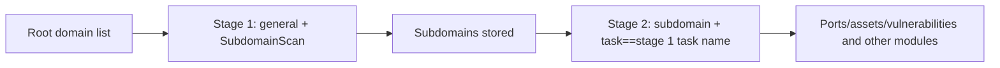

---

## name: scopesentry-mcp
description: Manage the security scanning platform (projects, tasks, templates, assets, nodes) through the ScopeSentry MCP. Use when the user mentions ScopeSentry, MCP, API Key, scan tasks, or asset queries.

# ScopeSentry MCP Usage Guide

For users of an **already-deployed ScopeSentry instance**. Connect to the platform through Cursor (or another MCP client); no local source code is needed.

## 1. Preparation

### 1.1 Confirm the service is reachable

- Default web UI: `http://<host>`
- MCP endpoint: `http://<host>/mcp` (if there is a reverse proxy or frontend proxy in front, use the actual `/mcp` address)

### 1.2 Create an API Key

1. Log in to the ScopeSentry web UI in a browser
2. Go to the **API Key** management page and create a key (or create one through an endpoint provided by your administrator)
3. Save the returned `ssk_...` string (**shown only once**)

### 1.3 Configure Cursor MCP

Cursor → Settings → MCP → Add server:

```json
{
  "mcpServers": {
    "scopesentry": {
      "url": "http://<your-host>:8082/mcp",
      "headers": {
        "X-API-Key": "ssk_your_key"
      }
    }
  }
}
```

You can also use: `Authorization: Bearer ssk_your_key`

After configuring, restart the MCP or reload Cursor, and confirm that tools such as `list_projects` and `list_assets` appear in the tool list.

---

## 2. Tool Overview


| Tool                   | Purpose           |
| ---------------------- | ----------------- |
| `list_projects`        | Project tree grouped by tag (includes project IDs) |
| `list_projects_data`   | Paginated project list, searchable by name |
| `get_project`          | Project details   |
| `create_project`       | Create a project  |
| `list_tasks`           | Scan task list    |
| `get_task`             | Task details      |
| `list_scan_templates`  | Scan template list |
| `get_scan_template`    | Template details  |
| `list_plugin_modules`  | Scan pipeline module names |
| `list_plugins`         | Available plugins (includes hash, default parameters) |
| `create_scan_template` | Create a scan template |
| `create_scan_task`     | Create a scan task |
| `list_assets`          | Query assets of every type (paginated list) |
| `count_assets`         | Count assets (`/api/assets/common/total`) |
| `get_asset_detail`     | Asset or vulnerability details |
| `add_asset_tag`        | Add a tag to an asset |
| `list_nodes`           | Scan node list    |


Parameters of each tool are governed by the MCP tool description (schema); `list_assets` / `count_assets` share the same search and filter syntax, so you can read the `list_assets` description before querying assets.

When you need to know "how many in total", use `count_assets` (it corresponds to the web UI's pagination-total endpoint); there is no need to page through `list_assets` repeatedly just to count.

---

## 3. Common Workflows

### 3.1 Query assets by project

When the user or the context **already has a project condition**, prefer including `filter.project` to narrow the scope, to avoid slow responses caused by too much cross-project data. If there is no explicit project, you do not have to force a project filter.

1. Use `list_projects` or `list_projects_data` to obtain the target project's **ObjectID** (`id` / `children[].value`)
2. Pass `filter.project` to `list_assets` (**it must be the ID, not the project's display name**)

```json
{
  "asset_type": "asset",
  "pageIndex": 1,
  "pageSize": 20,
  "search": "domain=^example.com",
  "filter": {
    "project": ["<project ObjectID>"]
  }
}
```

### 3.2 Create a scan task

1. `list_nodes` to get the names of online nodes
2. `list_scan_templates` or `create_scan_template` to get the template **ObjectID**
3. `create_scan_task`: `name` and `node` are required; `template` takes the template ID (not the template name)

**Target source `targetSource` (consistent with the web UI):**

| targetSource | Description | Required parameters |
| --- | --- | --- |
| `general` | Enter targets directly | `target` |
| `project` | Read targets from a project | `project` (array of project ObjectIDs) |
| `asset` | Search the web asset library | `search`; optional `project`, `filter`, `targetNumber` |
| `RootDomain` | Search the root-domain library | `search`; optional `project`, `filter`, `targetNumber` |
| `subdomain` | Search the subdomain library | `search`; optional `project`, `filter`, `targetNumber` |
| `UrlScan` | Search URL scan results | `search`; optional `project`, `filter`, `targetNumber` |
| `*Source` (e.g. `subdomainSource`) | Create from "selected/search" on an asset page | use `search` when `targetTp=search`; use `targetIds` when `targetTp=select` |

**Example — scan root domains directly:**

```json
{
  "name": "example-subdomain-collection",
  "node": ["node-1"],
  "template": "<template ObjectID>",
  "targetSource": "general",
  "target": "example.com\nfoo.com",
  "project": ["<project ObjectID>"]
}
```

**Example — continue scanning from the subdomain library (filtered by the previous task's name):**

```json
{
  "name": "example-ports-and-vulnerabilities",
  "node": ["node-1"],
  "template": "<follow-up module template ObjectID>",
  "targetSource": "subdomain",
  "search": "task==\"example-subdomain-collection\"",
  "project": ["<project ObjectID>"]
}
```

### 3.3 Complete root-domain information gathering (two stages recommended)

When the input is a **root domain** and you want **complete information gathering**, it is recommended to split it into two scans rather than running the full pipeline at once.

**Reason:** distributed tasks are dispatched per **single target**. When a root domain is the target, once a node is assigned that root domain, the subdomains it discovers on that node also continue through the later modules on that same node, which easily causes uneven load, slowness, and errors.

**Best practice:**

1. **Stage 1 — subdomain collection only**
   - `targetSource`: `general`
   - `target`: all root domains (multiple lines)
   - Template: enable only `SubdomainScan` and `SubdomainSecurity` (subdomain scanning + subdomain takeover)
   - Use `get_task` etc. to wait for the task to finish

2. **Stage 2 — follow-up modules**
   - `targetSource`: `subdomain`
   - `search`: `task=="<stage 1 task name>"` (exact match on the task name)
   - Optionally narrow the scope with `project`
   - Template: port scanning, asset mapping, vulnerability scanning, etc. (may omit SubdomainScan)
   - Subdomains are dispatched to the nodes as independent targets, giving better parallel efficiency

You can also filter by task name on the web UI's "Subdomain" asset page and use "Create task from subdomains", with the same effect.



### 3.4 Create a scan template

1. `list_plugin_modules` → list of module names
2. `list_plugins` (can be filtered by `module`) → each plugin's `hash` and default `parameter`
3. `create_scan_template`: use `modules` to specify "module → array of plugin hashes"

---

## 4. Asset Queries (`list_assets` / `count_assets`)

`count_assets` uses the same `asset_type`, `search`, and `filter` as `list_assets`, and returns `{ "total": N }`, corresponding to the web UI's `/api/assets/common/total`.

```json
{
  "asset_type": "subdomain",
  "search": "task==\"some task name\"",
  "filter": {"project": ["<project ObjectID>"]}
}
```

**Performance advice (common to `list_assets` / `count_assets`):** when there is a project condition, prefer `filter.project` to narrow the scope; in `search`, for indexed fields use `==` exact match or `^` prefix match wherever possible (see [4.3](#43-search-expressions)), and avoid wide-ranging `=` fuzzy queries that slow the response. Without a project context, do not force a project filter.

For the types that support `filter.project`, see the table in [4.4](#44-filter-exact-filtering).

### 4.1 Asset type `asset_type`

`asset`, `RootDomain`, `subdomain`, `app`, `mp`, `UrlScan`, `SensitiveResult`, `DirScanResult`, `crawler`, `vulnerability`, `PageMonitoring`, `IPAsset`, `SubdomainTakerResult`

Alias examples: `web`→asset, `vuln`→vulnerability, `ip`→IPAsset, `url`→UrlScan

### 4.2 Parameter reference


| Parameter                | Description                             |
| ------------------------ | --------------------------------------- |
| `pageIndex` / `pageSize` | Pagination, default 1 / 20              |
| `search`                 | Search expression (see next section)    |
| `filter`                 | Exact-filter JSON (see next section)    |
| `sort`                   | Only UrlScan and DirScanResult support sorting by `length` |
| `sid`                    | SensitiveResult only: sensitive rule name |


`search` and `filter` **can be used together**.

### 4.3 search expressions

A custom DSL (**not SQL**):


| Operator | Meaning | Index | Example                     |
| ---- | ---- | ---- | --------------------------- |
| `=`  | Fuzzy match (regex) | Does not use the index | `domain=example`            |
| `==` | Exact match (equality) | **Uses the index** | `port==443`                 |
| `!=` | Exclude | — | `port!="80"`                |
| `&&` | AND  | — | `domain==example.com && port==443` |
| `||` | OR   | — | `title=admin || body=login` |


**Indexes and operators:** fields such as `domain`, `ip`, `port`, and `title` are indexed, but only **`==` equality** or **prefix matching with a value starting with `^`** (e.g. `domain=^example.com`) can use the index; **`=` is converted to a regex fuzzy match and cannot use the index**, so it easily becomes slow on large data sets.

**Search fields common to all types:** `tag`, `task` (task name), `rootDomain`

**project cannot be written in search** (it is ineffective, or errors when combined with `&&`). Use `filter.project` to filter by project.

**Common search fields per type:**


| asset_type           | Fields                                                                              |
| -------------------- | ----------------------------------------------------------------------------------- |
| asset                | domain, ip, port, service, app, title, statuscode, icon, banner, type, body, header |
| RootDomain           | domain, icp, company                                                                |
| subdomain            | domain, ip, type, value                                                             |
| app                  | name, icp, company, category, description, url, apk                                 |
| mp                   | name, icp, company, category, description, url                                      |
| UrlScan              | url, input, source, resultId, type                                                  |
| SensitiveResult      | url, sname, body, info, md5                                                         |
| DirScanResult        | url, statuscode, redirect, length                                                   |
| vulnerability        | url, vulname, matched, request, response, level                                     |
| crawler              | url, method, body, resultId                                                         |
| PageMonitoring       | url, hash, diff, response                                                           |
| IPAsset              | ip, domain, port, service, webServer, app                                           |
| SubdomainTakerResult | domain, value, type, response                                                       |


**search examples:**

- `domain==www.example.com && port==443` (equality, uses the index)
- `domain=^example.com` (prefix match, uses the index)
- `ip==192.168.1.1`
- `task=="some task name"`
- `level==high` (vulnerability)
- `statuscode==200` (DirScanResult)

Use `=` only when you need fuzzy containment, such as `title=admin` (does not use the index; best combined with conditions such as project to narrow the scope).

### 4.4 filter exact filtering

A JSON object: multiple values under the same key are **OR**, different keys are **AND**.

**Prefer `project` when there is a project condition:** if the user or context has already specified a project and the asset_type supports `project`, include it to narrow the scope; do not force it when there is no project information.


| filter key   | Meaning  | Value notes                                              |
| ------------ | -------- | -------------------------------------------------------- |
| `project`    | Owning project | **ObjectID**, obtained with `list_projects` / `list_projects_data` |
| `task`       | Source task | **Task name**, use the `name` from `list_tasks`          |
| `port`       | Port     | e.g. `"443"`                                             |
| `service`    | Service/protocol | e.g. `"https"`                                   |
| `app`        | Application fingerprint | e.g. `"Nginx"`                            |
| `icon`       | Icon hash |                                                         |
| `statuscode` | HTTP status code | Mainly for asset                                 |
| `status`     | Status   | HTTP code for UrlScan/DirScan; handling status for vulnerabilities/sensitive information |
| `level`      | Vulnerability level | critical / high / medium / low / info         |
| `type`       | Type     | e.g. subdomain record types A, CNAME                     |
| `color`      | Sensitive-rule color | SensitiveResult                      |
| `sname`      | Sensitive-rule name | SensitiveResult                       |
| `tags`       | Tags     |                                                          |


**Available filter keys per type:**


| asset_type                            | filter key                                                      |
| ------------------------------------- | --------------------------------------------------------------- |
| asset                                 | project, port, service, app, icon, statuscode, type, task, tags |
| RootDomain                            | project, tags                                                   |
| subdomain                             | project, type, task, tags                                       |
| app / mp                              | project, tags                                                   |
| UrlScan                               | status, tags                                                    |
| DirScanResult                         | status, tags                                                    |
| SensitiveResult                       | status, color, sname, tags                                      |
| crawler                               | project, task, tags                                             |
| vulnerability                         | project, level, status, task, tags                              |
| PageMonitoring / SubdomainTakerResult | tags                                                            |
| IPAsset                               | project, port, service, app                                     |


**filter example:**

```json
{"project": ["<project ObjectID>"], "port": ["443"]}
```

**Combined query example:**

```json
{
  "asset_type": "asset",
  "search": "domain=^baidu && port==443",
  "filter": {"project": ["<project ObjectID>"]},
  "pageIndex": 1,
  "pageSize": 10
}
```

**Notes:**

- When there is a project condition, prefer including `filter.project` (where supported); without a project context it need not be forced
- Do not put a project display name in `filter.project`
- Use `==` for known values and `^` for prefixes; avoid overusing `=` fuzzy matching on large tables
- For UrlScan's HTTP status use `filter.status`; for DirScanResult you can use `statuscode==200` in search
- SensitiveResult by rule name: in `search` use `sname=<rule name>`, or `filter.sname`

### 4.5 Sorting with sort

Only **UrlScan** and **DirScanResult** support it:

```json
{"length": "ascending"}
```

Other types ignore `sort` and use the default time ordering.

---

## 5. Scan Template Module Names

`TargetHandler`, `SubdomainScan`, `SubdomainSecurity`, `PortScanPreparation`, `PortScan`, `PortFingerprint`, `AssetMapping`, `AssetHandle`, `URLScan`, `WebCrawler`, `URLSecurity`, `DirScan`, `VulnerabilityScan`, `PassiveScan`

---

## 6. Troubleshooting


| Symptom   | Fix                                                |
| --------- | -------------------------------------------------- |
| MCP has no tools | Check the URL, the API Key, and whether ScopeSentry is running |
| 401 / 403 | Recreate or replace the API Key                    |
| Assets not found | Confirm `filter.project` is an ObjectID; do not write project in search |
| Template/task creation fails | `template` must be a template ObjectID; `node` takes an online node name |
| Queries are very slow / hang | With a project, add `filter.project`; in search use `==` or the `^` prefix on indexed fields and use `=` sparingly; reduce `pageSize` |


---
